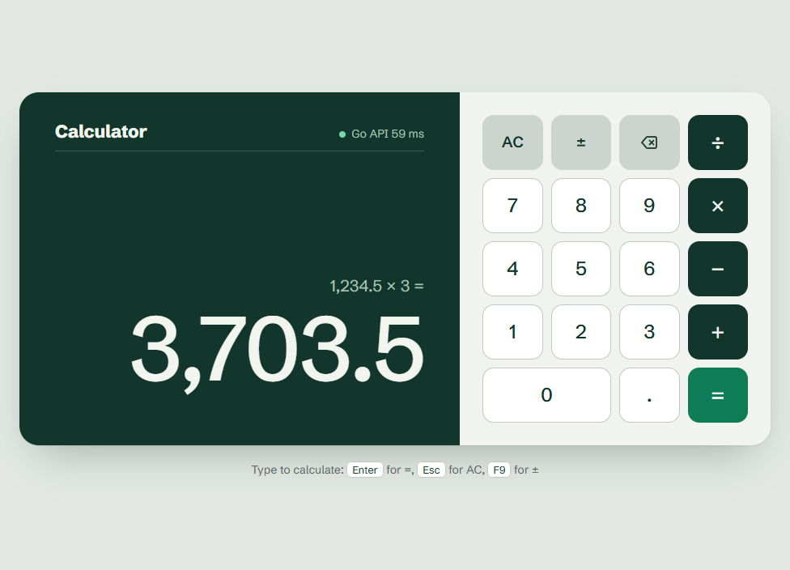
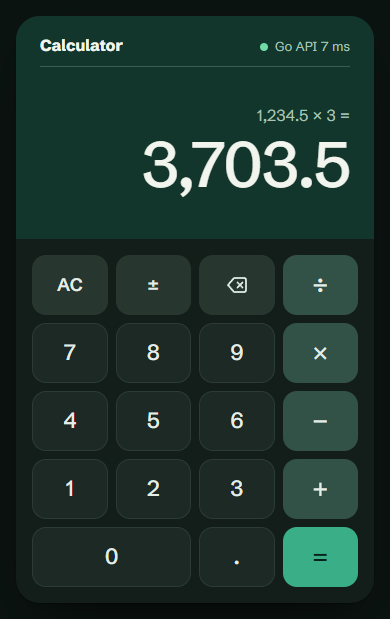

# Calculator: React frontend, Go API

A take-home assignment for Sezzle. A keypad calculator built with React and TypeScript calls a Go REST microservice, and the Go service does every calculation. The browser never computes a result.





## Contents

- [Features](#features)
- [Technology stack](#technology-stack)
- [Architecture](#architecture)
- [Prerequisites](#prerequisites)
- [Getting started](#getting-started)
- [Configuration and ports](#configuration-and-ports)
- [REST API](#rest-api)
- [How the calculator behaves](#how-the-calculator-behaves)
- [Keyboard shortcuts](#keyboard-shortcuts)
- [Numbers and floating point](#numbers-and-floating-point)
- [Testing and quality checks](#testing-and-quality-checks)
- [Test coverage](#test-coverage)
- [Design decisions and trade-offs](#design-decisions-and-trade-offs)
- [Known limitations and future work](#known-limitations-and-future-work)
- [Other documents](#other-documents)

## Features

- **Operations:** addition, subtraction, multiplication and division. Each step is one call to `POST /api/calculate`.
- **Input:** decimal and negative numbers, with up to 15 digits per entry.
- **Immediate execution:** `2 + 3 × 4 =` evaluates left to right (20), the way a basic calculator does.
- **Validation:** the API checks every request and returns errors in a consistent JSON shape with appropriate status codes. The UI turns these into plain-language messages that say how to recover.
- **Network failures:** an unreachable server, a timeout (10 s) or a stopped backend each show a clear message, and pressing `=` retries.
- **Input never lost:** keys typed while a request is in flight are queued and applied in order once the answer arrives.
- **Keyboard and mouse:** full keyboard support, with visible focus and screen-reader announcements for results and errors.
- **Layout and themes:** responsive from 320 px phones to desktop (split layout at 896 px and wider), with light and dark themes following the OS setting.
- **API status indicator:** a small status in the corner of the display. It is derived from the requests you make, so nothing polls the server.

## Technology stack

| Layer | Technology |
|---|---|
| Backend | Go, standard library only (`net/http`, `encoding/json`, `log/slog`). No third-party modules |
| Frontend | React 19, TypeScript 6, Vite 8, plain CSS. Runtime dependencies are `react` and `react-dom` only |
| Font | Schibsted Grotesk, self-hosted WOFF2 (SIL Open Font License, see `frontend/src/assets/fonts/OFL.txt`) |
| Backend tests | Go `testing` and `net/http/httptest` |
| Frontend tests | Vitest 5, React Testing Library, jsdom, V8 coverage |
| Linting | `gofmt`, `go vet`, staticcheck; ESLint with typescript-eslint |

## Architecture

```text
Browser (React)                         Go service
───────────────                         ──────────
Keypad / keyboard
      │ action
      ▼
reducer.ts ── records a pending ──► useCalculator.ts ── fetch ──► POST /api/calculate
(input state, no arithmetic)        request; sends it                     │
      ▲                                                        internal/api (decode, validate,
      │ result or error                                         map errors to HTTP)
      └──────────────── calculate.ts (typed client) ◄──── JSON ──┤
                                                        internal/calculator (pure arithmetic)
```

- **Backend:** the arithmetic lives in `internal/calculator`, which knows nothing about HTTP. `internal/api` turns requests into calls to it and maps its errors to status codes.
- **Frontend:** the reducer is a pure state machine for keypad input. When a calculation is needed it records a *pending request*. The `useCalculator` hook sends it and dispatches the outcome. Request ids let late or cancelled responses be ignored.

```text
.
├── backend/
│   ├── cmd/server/main.go          server entry point: ADDR, timeouts, graceful shutdown
│   └── internal/
│       ├── calculator/             arithmetic and its errors (pure, table-tested)
│       └── api/                    routing, JSON decoding/validation, error mapping, middleware
├── frontend/
│   ├── src/api/calculate.ts        typed API client (timeouts, error types)
│   ├── src/calculator/             reducer, hook, keypad map, formatting, error messages
│   ├── src/components/             Calculator, Display, Keypad, ApiStatus (+ CSS)
│   └── vite.config.ts              dev/preview proxy and Vitest configuration
├── coverage/                       committed coverage reports (backend.txt, frontend.txt)
├── docs/                           QA report, design review, README screenshots
├── AI_USAGE.md                     prompts used and how AI assistance was applied
└── PRODUCT.md                      product brief used during design reviews
```

## Prerequisites

| Tool | Version |
|---|---|
| Go | **1.22 or newer.** This is the minimum declared in `backend/go.mod` (method-based routing in `net/http` needs 1.22). Developed and tested with Go 1.27.0 |
| Node.js | **^22.22.2, ^24.15.0 or ≥ 26.** This is the overlap of the frontend toolchain's declared requirements (jsdom, Vitest, Vite, ESLint), recorded in `frontend/package.json` under `engines`. Developed and tested with Node 24.15.0 and npm 11.12.1 |
| Git | Any recent version |

No database, account or AI tooling is needed to build, run or test the project.

## Getting started

Clone the repository:

```bash
git clone https://github.com/ErdemAkaySabanci/sezzle-calculator.git
cd sezzle-calculator
```

The backend and frontend each run in their own terminal. These commands are the same in bash and Windows PowerShell.

### 1. Start the Go API

```bash
cd backend
go run ./cmd/server
```

The server logs `msg=listening addr=localhost:8080`. Stop it with **Ctrl+C**, which shuts it down gracefully with a 5 s grace period.

### 2. Start the React frontend

In a second terminal:

```bash
cd frontend
npm ci
npm run dev
```

Open **http://localhost:5173**. `npm ci` installs the exact versions in `package-lock.json`, and you only need it once.

### Production build (optional)

```bash
cd frontend
npm run build      # type-checks, then writes dist/
npm run preview    # serves dist/ on http://localhost:4173 with the same /api proxy
```

## Configuration and ports

| Port | Process |
|---|---|
| 8080 | Go API (`localhost:8080` by default) |
| 5173 | Vite dev server (`npm run dev`) |
| 4173 | Vite preview of the production build (`npm run preview`) |

The frontend calls the API with relative URLs (`/api/calculate`). In development and preview, Vite proxies `/api` to the Go server, so no CORS configuration is needed and no URL is hard-coded.

| Variable | Used by | Default | Purpose |
|---|---|---|---|
| `ADDR` | Go server | `localhost:8080` | Listen address. Use `:8080` inside a container to listen on all interfaces |
| `API_PROXY_TARGET` | `vite.config.ts` | `http://localhost:8080` | Where the dev/preview proxy sends `/api` |
| `VITE_API_BASE_URL` | frontend build | *(empty: same origin)* | API origin for a deployment where the API is on another host. That host would also need CORS, which is not implemented |

Setting a variable for one run:

```bash
ADDR=localhost:9090 go run ./cmd/server              # bash
API_PROXY_TARGET=http://localhost:9090 npm run dev   # bash
```

```powershell
$env:ADDR = "localhost:9090"; go run ./cmd/server               # PowerShell
$env:API_PROXY_TARGET = "http://localhost:9090"; npm run dev    # PowerShell
```

## REST API

### `POST /api/calculate`

Request headers: `Content-Type: application/json`. The body is limited to 1 KB.

```json
{ "operation": "divide", "a": 10, "b": 4 }
```

- `operation` is one of `add`, `subtract`, `multiply`, `divide`. It is case-sensitive.
- `a` and `b` are required JSON numbers. A missing or `null` operand is rejected; it is never treated as 0.
- Unknown fields are rejected.

Success, `200 OK`:

```json
{ "result": 2.5 }
```

### `GET /api/health`

Returns `200 OK` with `{"status":"ok"}`.

### Errors

Every error, including 404 and 405, uses the same JSON envelope:

```json
{ "error": { "code": "DIVISION_BY_ZERO", "message": "cannot divide by zero" } }
```

| Status | `code` | When |
|---|---|---|
| 400 | `INVALID_JSON` | Malformed or truncated JSON, empty body, wrong types (`"a":"1"`), unknown fields, trailing data, numbers outside float64 range (`1e400`) |
| 400 | `INVALID_OPERATION` | `operation` missing, empty or unsupported |
| 400 | `INVALID_OPERAND` | `a` or `b` missing or `null` |
| 404 | `NOT_FOUND` | Unknown route |
| 405 | `METHOD_NOT_ALLOWED` | Wrong method (the response includes an `Allow` header) |
| 413 | `PAYLOAD_TOO_LARGE` | Body larger than 1024 bytes |
| 415 | `UNSUPPORTED_MEDIA_TYPE` | `Content-Type` is not `application/json` |
| 422 | `DIVISION_BY_ZERO` | `b` is 0 (including `0/0`) |
| 422 | `NON_FINITE_RESULT` | The result overflows to ±Infinity (e.g. `1e308 × 10`) |
| 500 | `INTERNAL_ERROR` | Unexpected server error (panics are recovered) |

400 means the request itself is invalid. 422 means the request is well-formed but has no finite answer.

### Examples

These responses were captured from the running server.

```console
$ curl -s -X POST http://localhost:8080/api/calculate -H 'Content-Type: application/json' -d '{"operation":"add","a":0.1,"b":0.2}'
{"result":0.30000000000000004}

$ curl -s -X POST http://localhost:8080/api/calculate -H 'Content-Type: application/json' -d '{"operation":"multiply","a":-2.5,"b":-4}'
{"result":10}

$ curl -s -i -X POST http://localhost:8080/api/calculate -H 'Content-Type: application/json' -d '{"operation":"divide","a":1,"b":0}'
HTTP/1.1 422 Unprocessable Entity
{"error":{"code":"DIVISION_BY_ZERO","message":"cannot divide by zero"}}

$ curl -s -i -X POST http://localhost:8080/api/calculate -H 'Content-Type: application/json' -d '{"operation":"add","a":1}'
HTTP/1.1 400 Bad Request
{"error":{"code":"INVALID_OPERAND","message":"\"b\" is required and must be a number"}}

$ curl -s -i -X POST http://localhost:8080/api/calculate -H 'Content-Type: application/json' -d '{"operation":"add","a":1e400,"b":1}'
HTTP/1.1 400 Bad Request
{"error":{"code":"INVALID_JSON","message":"invalid value for \"a\": expected a finite number"}}

$ curl -s -i http://localhost:8080/api/calculate
HTTP/1.1 405 Method Not Allowed
Allow: POST
{"error":{"code":"METHOD_NOT_ALLOWED","message":"method GET is not allowed; use POST"}}
```

In Windows PowerShell, `curl` is an alias for `Invoke-WebRequest`. Use `Invoke-RestMethod` instead:

```powershell
Invoke-RestMethod -Method Post -Uri http://localhost:8080/api/calculate `
  -ContentType 'application/json' -Body '{"operation":"divide","a":10,"b":4}'
```

## How the calculator behaves

- **Immediate execution.** Pressing an operator while one is pending first sends the pending step to the API. So `2 + 3 × 4 =` sends `add 2 3`, then `multiply 5 4`, and shows **20**. There is no operator precedence.
- **Repeated operator.** Pressing two operators in a row replaces the first and sends nothing.
- **Continuing from a result.** After a result, pressing an operator continues from it, and typing a digit starts a new number. The next step uses the API's exact result, not the rounded value on screen.
- **Typing ahead.** Keys pressed while a request is in flight are queued, applied in order when the answer arrives, and counted in the status ("2 queued"). Pressing `=` again while waiting does not send a duplicate request.
- **Errors.** The operands are kept. After `8 ÷ 0`, typing `2` replaces the 0 and `=` gives 4. After a network error, `=` retries. Keys typed ahead of a failed request are dropped.
- **Clear and edit.** **AC** clears everything and cancels an in-flight request; its late response is ignored. **⌫** edits the number being typed, and **±** toggles its sign.
- **API status** (top right of the display):
  - **Go API**: no request yet.
  - **Calculating…**: a request is in flight.
  - **Go API 12 ms**: the last response time.
  - **Go API online**: the server answered with an error such as 422.
  - **Go API offline**: the server could not be reached, timed out, or returned a 5xx error.

## Keyboard shortcuts

| Key | Action |
|---|---|
| `0`–`9` | Digits |
| `.` or `,` | Decimal point |
| `+` `-` `*` `/` | Add, subtract, multiply, divide (`x` also multiplies) |
| `Enter` or `=` | Equals |
| `Backspace` | Delete the last digit |
| `Escape` or `Delete` | Clear (AC) |
| `F9` | Toggle sign (±) |

Shortcuts with Ctrl, Alt or Cmd are left to the browser. When a keypad button has keyboard focus, `Enter` and `Space` press that button.

## Numbers and floating point

- **Arithmetic is IEEE-754 float64** (Go `float64`). The API returns results unrounded, for example `0.1 + 0.2` gives `0.30000000000000004`.
- **The UI rounds only for display.** It shows up to 15 significant digits, so the same result appears as `0.3`. Values of 10¹⁵ and above, or below 10⁻⁶, use exponent notation (`9.99999899999999e+21`).
- **The rounding never feeds back.** When you continue from a result, the API's raw value is sent, not the rounded display.
- **Entry is limited to 15 digits,** because float64 reliably round-trips 15 significant decimal digits. Integers above 2⁵³ (about 9 × 10¹⁵) cannot all be represented exactly.
- **`-0` becomes `0`** in API results.
- **NaN and ±Infinity are never accepted or returned.** JSON cannot encode them, overflowing results are rejected with 422, and the client refuses to send non-finite operands.

## Testing and quality checks

### Backend

Run from `backend/`:

```bash
go test ./...                                              # unit tests
gofmt -l .                                                 # formatting (prints nothing when clean)
go vet ./...                                               # static analysis
go run honnef.co/go/tools/cmd/staticcheck@v0.8.2 ./...     # staticcheck (downloads the tool on first use)
```

The suite has 20 test functions with 86 subtests. It covers:
- each operation with negatives, decimals and operand order;
- division by zero (including `0/0` and `-0`);
- overflow, `-0` normalisation, and non-finite operands;
- every row of the error table above;
- the JSON 404/405 responses, panic recovery and request logging.

### Frontend

Run from `frontend/`:

```bash
npm run lint         # ESLint
npm run typecheck    # tsc -b
npm run build        # type-check and production build
npm test             # Vitest, 182 tests in 7 files
```

The tests cover:
- the API client: request shape, error types, timeout, abort and non-finite operands;
- the keypad reducer: entry, chaining, queued input, stale responses and errors;
- display formatting, including width estimates checked against glyph widths measured in Chrome;
- the keyboard map;
- the rendered `Calculator`, driven by mouse and keyboard against a fake `fetch`.

The browser was also checked by hand with Playwright CLI in Chrome, across functional, responsive and axe accessibility scenarios. The results are in [docs/qa-report.md](docs/qa-report.md). Those scripts are not part of the repository.

## Test coverage

The committed reports are [`coverage/backend.txt`](coverage/backend.txt) and [`coverage/frontend.txt`](coverage/frontend.txt). They come from the commands below and were last regenerated on 2026-10-20.

**Backend (Go)**

| Package | Statement coverage |
|---|---|
| `internal/calculator` | 100.0% |
| `internal/api` | 98.7% |
| `internal/...` combined | 98.9% (93 of 94 statements) |
| `cmd/server` | 0.0% (32 statements, no tests) |
| **Overall, as reported by `go tool cover`** | **73.8%** (93 of 126 statements) |

- **Why the overall figure is lower:** `cmd/server` only wires the process together (the `ADDR` variable, server timeouts and signal handling). It has no unit tests, and its 32 statements pull the total down. All application logic is in the `internal` packages.
- **The one uncovered `internal` statement** is the HTTP 500 fallback for an unexpected calculator error. No valid request can reach it.

**Frontend (Vitest, V8)**

| Metric | Coverage |
|---|---|
| Statements | 99.42% (173/174) |
| Branches | 100% (198/198) |
| Functions | 97.67% (42/43) |
| Lines | 99.33% (150/151) |

Every module is at 100% except `App.tsx`, the page wrapper around the tested `Calculator` component. It is not rendered by the unit tests.

**Regenerating the reports**

```bash
# backend/
go test ./... -coverprofile=coverage.out
go tool cover -func=coverage.out          # per-function table and overall total
go tool cover -html=coverage.out          # line-by-line view in the browser

# frontend/
npm run test:coverage                     # table in the terminal; HTML in frontend/coverage/index.html
```

`coverage.out` and `frontend/coverage/` are git-ignored. Only the text summaries in `coverage/` are committed.

## Design decisions and trade-offs

- **Business logic is separate from HTTP.** `internal/calculator` is pure and table-tested; the handler only decodes, validates and maps errors. Optional operations can be added there without touching transport code.
- **Strict request decoding.**
  - Operands are decoded as `*float64`, so a missing or `null` value is an error, not 0.
  - Unknown fields and trailing data are rejected.
  - The body is limited to 1 KB.
  - Numbers outside float64 range are rejected at the JSON layer, and the calculator checks again.
- **400 versus 422.** 400 means the client sent an invalid request. 422 means a valid request has no finite answer.
- **Raw results, display-only rounding.** The API is exact to float64, and the UI hides binary noise without ever feeding rounded values back. Arbitrary-precision decimal arithmetic would remove the noise but add a dependency; that was judged unnecessary for a four-function calculator.
- **Immediate execution, not expression parsing.** It matches a basic calculator, and every step is one simple API call. The trade-off is that there is no operator precedence.
- **Keys typed while waiting are queued, not dropped.** In browser QA, a fast `2+3*4⏎` showed 5 instead of 20 when keys typed during a request were ignored. Queuing fixed it.
- **No CORS; a same-origin proxy instead.** Vite proxies `/api` in development and preview. A split-origin deployment would need CORS or a reverse proxy.
- **Visual design ("Annual Report").**
  - On desktop, the result is set at headline size on an evergreen panel beside a conventional keypad.
  - Light and dark themes follow the OS.
  - Text contrast meets WCAG 2.2 AA, with the lowest pair at 4.94:1.
  - The reasoning and the review findings are in [docs/design-review.md](docs/design-review.md).
- **Server address.** It defaults to `localhost:8080` rather than all interfaces, which avoids a Windows firewall prompt on every `go run`. Containers set `ADDR=:8080`.

## Known limitations and future work

- **Operations.** Only the four required operations are implemented. Exponentiation, square root and percentage are planned next.
- **No race detector run.** `go test -race` needs cgo and a C toolchain, which were not installed on the development machine.
- **Graceful shutdown untested.** The Ctrl+C path is not covered by automated tests.
- **Limited browser coverage.**
  - Verified in Chrome, desktop and emulated mobile only; not in Firefox or Safari.
  - Accessibility was checked with axe-core and by inspecting the live-region markup, not with a real screen reader. That supports AA for what was tested, but it is not a full WCAG audit.
- **No committed end-to-end suite.** A Playwright test suite in CI would make the browser checks repeatable.
- **Not production-ready deployment.** There is no CORS, authentication, rate limiting, Dockerfile or CI workflow. None were required for this assignment.
- **Input limits.**
  - Keys typed while a request is in flight are not shown until the result arrives.
  - The ± key on the keyboard is `F9`, which needs `Fn` on many laptop keyboards.

## Other documents

| Document | Contents |
|---|---|
| [AI_USAGE.md](AI_USAGE.md) | The prompts used during development and how AI assistance was applied |
| [docs/qa-report.md](docs/qa-report.md) | Browser QA scenarios, accessibility results, defects found and fixed |
| [docs/design-review.md](docs/design-review.md) | Design critique findings and the decisions taken |
| [coverage/](coverage/) | Backend and frontend coverage reports |
| [PRODUCT.md](PRODUCT.md) | Product brief (audience, principles, constraints) used during design reviews |
